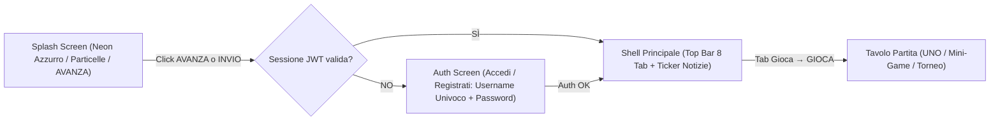

# CONTENUTO GAME — Specifica Scientifica, Audit Completo e Analisi Avversativa di **UNO ULTRA**

> **Versione Documento:** 1.1 (Master Specification + Engineering Review & Blocking Decisions)  
> **Fonti di Riferimento Primarie:** `uno-ultra/` (`dentro il gioco.txt`, `UNO_ULTRA_v68_Documento_Tecnico`, `UNO_ULTRA_Bot_Ecosystem_Analysis`, `Filo_Logico_Contenuto_Gioco_UNO_ULTRA`, `Piano_Tecnico_Implementazione`, `INDICE_v52`, `ANALISI_COMPARATIVA`, `PIANO`) + codebase attuale `uno ultra game/`.  
> **Vincolo Operativo:** Questo documento consolida l'intera architettura funzionale, matematica e sistemica del gioco senza alterare il codice sorgente.

---

## 1. Intestazione, Metodologia e Perimetro del Progetto

### 1.1 Scopo
Definire in forma rigorosa, verificabile e priva di ambiguità:
1. L'intero inventario di **meccaniche, funzioni UI, mini-game, oggetti, economia, ricompense, stagioni, negozio, armadietto, Battle Card, tornei, ranked, sistema bot e multiplayer** derivato da `uno-ultra/`.
2. La **mappatura completa** degli elementi presenti in `uno-ultra/` che rischiavano di essere omessi nella migrazione verso `uno ultra game/`.
3. La progettazione tecnica delle **nuove proposte architetturali**:
   - Bot dotati di **API Gemini Native** per modulazione del QI/bravura in funzione del Rank.
   - Multiplayer su **Docker + Dual Protocol (TCP autoritativo + UDP real-time)** con **sistema di inviti interno**, **unicità globale dello username** e **persistenza coordinata offline/online**.
4. Una **revisione puntuale dei file multiplayer esistenti** nel monorepo `uno ultra game/`.
5. Un'**Analisi Avversativa (Red Team)** seguita da un **Piano di Potenziamento Prioritizzato**.

### 1.2 Principio Invariante di Verità
Ogni funzionalità competitiva, economica o di identità segue il principio di **Autorità Server-Side**:
$$\text{Client} = \text{Presentazione} + \text{Input} + \text{Cache Offline Locale} \qquad \text{Server} = \text{Stato Autoritativo} + \text{Validazione} + \text{Economia}$$
Nessun dato economico (`V-Card`, `Crediti Torneo`, `Battle Card`, acquisti, `MMR` ranked, titoli sbloccati) può essere considerato attendibile se generato o mutato solo lato browser.

---

## 2. Architettura UX, Flussi di Navigazione e Accessibilità

### 2.1 Flusso di Ingresso


### 2.2 Splash Screen e Shell Principale (`dentro il gioco.txt`)
| Componente | Posizione / Aspetto | Comportamento Scientifico |
|---|---|---|
| **Sfondo Particelle** | Canvas fullscreen `#05070d` | 60 particelle ciano (`#00bcd4`) a 60fps via `requestAnimationFrame`. |
| **Titolo & CTA Iniziale** | Centro schermo | Titolo `UNO ULTRA` in neon azzurro + rettangolo giallo cubitale (`#F5C842`) con testo nero `AVANZA`. |
| **Schermata Auth** | Fullscreen glassmorphism | Toggle `Accedi` / `Registrati`. Richiede **Username univoco** e **Password** (hash `bcrypt` ≥12 round sul server). |
| **Top Bar (8 Tab)** | Barra superiore fissa | `Gioca`, `Negozio`, `Armadietto`, `Battle Card`, `Sfide`, `Tornei`, `Carriera`, `V-Card`. |
| **Barra Notizie (Ticker)** | Sotto la Top Bar | Pannello rettangolare auto-scrollante; al click si espande a **schermo intero** nascondendo temporaneamente le tab; si chiude con `X` in alto a destra o `ESC`. |
| **Regola Globale `ESC`** | Ovunque nell'app | Chiude modali/drawer → chiude notizie/overlay → apre menu uscita in partita → riporta alla vista precedente/Lobby `Gioca`. |

### 2.3 Scena `Gioca` (Home Lobby)
- **Centro Scena**: carta UNO animata che ruota sul proprio asse (`rotateY`) con **nome giocatore**, **livello Battle Card** (in piccolo) e, se la modalità competitiva è attiva, il **simbolo Rank**.
- **Slot Party (`+`)**: `1` pulsante `+` a sinistra e `2` pulsanti `+` a destra della carta centrale (per comporre un party fino a 4 giocatori). Cliccandoli si apre il **Drawer Sociale** laterale destro (vedi §10.3).
- **Launcher Quadrato (Basso-Sinistra)**:
  - Sopra: nome della modalità selezionata (`UNO`, `BlackJack`, ecc.).
  - Centro: selettore modalità con due tab interne: **Tab 1 — Modalità** (`UNO`, `BlackJack`, `Scala 40`, `Ruba Mazzetto`, `Scopa`, `Poker Texas Hold'em`, `Burraco`, `Mille Miglia` + varianti `Ranked`/`Casual`/`Blitz`/`Chaos`) e **Tab 2 — Numero Giocatori** (`Duello 1v1 / 2P`, `3P`, `4P`, più supporto futuro `1P vs Bot` e `2v2`/`3v3`).
  - Sotto: toggle **Modalità Competitiva (Ranked ON/OFF)** e CTA `GIOCA`.
- **Widget Progresso (Basso-Destra)**: cerchio con livello raggiunto nel **Battle Card**; quando `Ranked` è attivo, a destra compare il **simbolo del Rank** con **anello circolare di avanzamento** che indica graficamente quanto manca alla divisione o tier successivo.

### 2.4 Accessibilità (WCAG 2.1 AA — da `Piano_Tecnico` & `INDICE_v52`)
- **Dialogo NVDA** all'avvio (opzionale/skip) per annunci screen-reader (`aria-live`).
- **Focus trap** sui modali, skip-link da tastiera, navigazione completa con `Tab` / `Frecce` / `Invio` / `Esc`.

---

## 3. Meccaniche Core di UNO e Varianti Regolamentari

### 3.1 Mazzo Standard e Struttura Carta
- **Mazzo**: `108` carte ufficiali divise in `4` colori (`red`, `yellow`, `green`, `blue`) + `wild`.
  - Per ciascuno dei 4 colori: uno `0`, due copie per ciascun numero `1–9`, due `skip` (Salta), due `reverse` (Inversione), due `draw2` (`+2`).
  - Carte nere (`wild`): quattro `wild` (Cambio Colore) e quattro `wild_draw4` (`+4`).
- **Mano iniziale**: `7` carte per giocatore (`initialHandSize = 7`). Prima carta degli scarti pescata tra le carte non-wild (nel prototipo v68) oppure secondo regola iniziale definita in `UnoRoom`.

### 3.2 Regole di Gioco e Casi Critici Verificati
| Meccanica | Specifica Formale | Stato nel Codebase Attuale |
|---|---|---|
| **Validazione Mossa `canPlay()`** | Giocabile se: (a) `pendingDraw > 0` e carta ammette stacking; oppure (b) `kind === 'wild'`; oppure (c) `color === activeColor` o stesso `value` o stessa `kind`. | ✅ Implementato in `shared/src/engine/uno/rules.ts` |
| **Stacking `+2` / `+4`** | Accumulo di `pendingDrawCount` finché i giocatori concatenano carte draw ammesse. Cap massimo `STACKING_CAP = 20`, soglia di sicurezza `OVERLOAD = 30`. | ✅ Parametrizzato in `DEFAULT_UNO_RULES` |
| **Inversione in Duello (1v1)** | Con `2` giocatori attivi, `reverse` equivale funzionalmente a uno `skip` (il giocatore mantiene il turno). | ✅ Implementato nel motore puro |
| **Contestazione Wild `+4`** | Flag `lastWildDraw4WasLegal` calcolato **al momento del play** (true sse il giocatore non aveva carte di `activeColor` in mano). Se lo sfidante ha ragione → chi ha giocato `+4` pesca `4` carte; se ha torto → lo sfidante pesca `6` carte. | ✅ Logica pura + pulsante `SFIDA +4` attivi; ⚠️ in `uno-ultra` era solo testo UI |
| **Dichiarazione `UNO!`** | Quando un giocatore scende a `1` carta (`UNO_CALL_THRESHOLD = 1`), deve dichiarare `UNO!`. Mancata dichiarazione comporta penalità `UNO_PENALTY_DRAW = 2` carte. | ✅ Presente `call_uno` + check nel reducer |
| **Timeout Turno & Watchdog** | Turno standard `30s` sul server (`15s` in v68); a scadenza il server forza `draw_card`. | ✅ Implementato in `UnoRoom` (`turnTimer`) |
| **Segretezza Mani Private** | Le mani dei giocatori NON entrano mai nello state pubblico sincronizzato di Colyseus (`cardCount` pubblico, carte inviate privatamente su canale `hand`). | ✅ Implementato in `UnoRoom` & `UnoController` |

### 3.3 Modalità e Varianti UNO
| Variante | Parametri Distintivi | Moltiplicatore MMR |
|---|---|---|
| **UNO Ranked** | Regole competitive autoritative (`1v1`, `3P`, `4P`), aggiorna `mmrP` e `P.mmr`. | `×1.0` |
| **UNO Casual** | Nessun impatto sul rank principale; match rapidi / allenamento. | `×0.5` (playlist casual separata) |
| **UNO Blitz** | Timer turno ridotto + timer globale partita `120s`. | `×1.2` (`p1_blitz`) |
| **UNO Chaos** | Modificatori di regole attivi (stacking esteso, swap mani / 7-0, multi-action). | `×0.9` (`p1_chaos`) |
| **Team 2v2 / 3v3** | Squadre contrapposte con logica di collaborazione alleata. | `×0.65` (`2v2`), `×0.55` (`3v3`) |
| **Custom Game / Preset** | Lobby regole personalizzate salvabili (`uno-cg-presets-v1`): timer turno, `stackLimit`, `w4Contest`, `initialHandSize`, punteggio target. | `0` (no MMR) |

---

## 4. Catalogo Completo dei Mini-Game (8 Giochi + Pentathlon)

Da `uno-ultra/` e `shared/src/constants/game-modes.ts`, la piattaforma ospita **8 giochi principali** più il formato combinato **Pentathlon**:

| # | Gioco | Giocatori | Regole & Loop Principale | Playlist MMR | Stato Attuale in `uno ultra game` |
|---:|---|---|---|---|---|
| 1 | **UNO** | 1v1, 3P, 4P (+ Team) | Mazzo 108 carte, stacking, challenge `+4`, `UNO!`. | `p1`, `p3`, `p4`, `p1_casual`, `p1_blitz`, `p1_chaos`, `p_2v2`, `p_3v3` | ✅ Motore + Server `UnoRoom` + UI Tavolo attivi |
| 2 | **Blackjack** | 1vBanco / 1–3 tavoli | `hit`, `stand`, `double`, punteggio 21, gestione puntate chips virtuali; 3 livelli difficoltà tavolo in v68. | `p_bj1`, `p_bj2`, `p_bj3` | ⚠️ Solo placeholder `blackjack-room.ts` & `.gitkeep` |
| 3 | **Scala 40** | 2–4P | Pesca/scarto, apertura ≥40 punti con tris/scale, attacco alle combinazioni a terra, chiusura. | `p_scala` | ⚠️ Solo placeholder `scala40-room.ts` & `.gitkeep` |
| 4 | **Ruba Mazzetto** | 2–4P | Mazzo italiano 40 carte, presa per valore corrispondente e furto dell'intero mazzetto avversario se carta scoperta coincide. | `p_ruba` | ⚠️ Solo placeholder `.gitkeep` |
| 5 | **Scopa** | 2P / 4P coppie | Mazzo italiano 40 carte, prese singole o somma valori, Scopa (+1), Settebello, Denari, Primiera, Carte. | `p_scopa` | ⚠️ Solo placeholder `scopa-room.ts` & `.gitkeep` |
| 6 | **Poker Texas Hold'em** | 2–6P | Bui, pre-flop, flop, turn, river, showdown, `fold`/`check`/`call`/`raise`, side pot virtuali (solo chips non reali). | `p_poker` | ⚠️ Solo placeholder `.gitkeep` |
| 7 | **Burraco** | 2P / 4P coppie | 2 mazzi francesi + jolly, pozzetti da 11 carte, scale e tris, chiusura con burraco puro/impuro. | `p_burraco` | ⚠️ Solo placeholder `.gitkeep` |
| 8 | **Mille Miglia** | 2P | Carte distanza (25–200 km) fino a 1000 km, imprevisti, rimedi e sicurezze (Asso al volante, Cisterna, ecc.). | `p_mille` | ⚠️ Solo placeholder `.gitkeep` |
| ★ | **Pentathlon Multiversus** | Torneo | Sfida sequenziale su 5 giochi (`UNO + Scopa + Burraco + Poker + Mille Miglia`) con accumulo punti e trofeo finale dedicato. | — (evento) | ❌ Non ancora migrato nel monorepo |

---

## 5. Economia, Items, Negozio, Armadietto e V-Card

### 5.1 Tassonomia delle Valute Virtuali (Zero Real-Money)
| Valuta | Acquisizione | Utilizzo | Vincolo Integrità |
|---|---|---|---|
| **V-Card (`V-Coins`)** | Battle Card (fino a `1000` per stagione: `500` free + `500` premium), sfide, progressione iniziale (`1000` in repo B). | Acquisto **Battle Card** (`1000` base / `1500` +20 lv), cosmetici e bundle nel **Negozio**. | Saldo + ledger transazioni su PostgreSQL con lock di riga (`FOR UPDATE`). |
| **Crediti Torneo** | Piazzamento nei Tornei (scalato per posizione finale e Rank del torneo). | Acquisto casse casuali nel **Negozio Tornei** (`100` / `500` / `1000` crediti). | Transazione atomica server-side. |
| **XP (Esperienza)** | Partite completate, `Double XP (2XP)`, `Daily Login Streak`, Sfide. | Avanzamento livello globale (`floor(100 × 1.35^lv)`) e livelli **Battle Card (1–100)**. | Calcolata esclusivamente dal server a fine match autoritativo. |
| **Chips Virtuali** | Bonus di gioco / daily login (per Blackjack/Poker senza valore reale). | Puntate nei mini-game da tavolo. | Mai convertibili in denaro o V-Card. |

### 5.2 Tassonomia degli Items Cosmetici
Tutti gli item equipaggiati nell'**Armadietto** devono essere **visibili a tutti i partecipanti sia in lobby sia al tavolo di gioco**:
1. **Cornici Avatar** (statiche e animate per rarità/rank).
2. **Stili Carte & Cardback** (dorsi carta neon, temi torneo gold/UCS, fronti stilizzati).
3. **Avatar Personalizzabili** (base, colori, accessori salvati via configuratore avatar).
4. **Targhette / Titoli** (mostrati sopra il nome utente in lobby e in partita; includono titoli Rank, titoli Sfide, titoli Stagionali irripetibili e 25 titoli UCS/RLCS animati).
5. **Temi Tavolo & Effetti FX** (es. `Cyber Blue`, `Lava Red`, `UCS Dark-Wood Gold`).
6. **Emote in-game** (reazioni rapide al tavolo).

### 5.3 Tab `Negozio` e Tab `V-Card`
- **Layout Negozio**: pannelli rettangolari con anteprima visiva + scroll verticale per la sezione **Scopra** (articoli singoli e **Bundle**).
- **Primo Piano Battle Card**: cliccando sul banner in primo piano si apre una pagina fullscreen (nascondendo le tab superiori, chiusura via `X` / `ESC`) con due opzioni:
  - **Sinistra — `1000 V-Card`**: sblocca il tracciato Premium del Battle Card dal livello corrente.
  - **Destra — `1500 V-Card`**: sblocca il tracciato Premium **+ `20` livelli di progresso immediato**.
- **Flusso Acquisto**: al click su compra appare il **pop-up riepilogativo dell'oggetto** con bottone diretto **`Equipaggia ora`** (che aggiorna automaticamente lo slot nell'Armadietto).
- **Tab `V-Card`**: pannello dedicato alla gestione saldo `V-Card`, storico entrate/uscite (`transactions`) e dettagli su come ottenere crediti gratuitamente tramite gameplay/Battle Card/sfide.

### 5.4 Tab `Armadietto` e Gestione Duplicati
- Raccoglie tutti gli item posseduti divisi per categoria: `Cornici Avatar`, `Stili Carte`, `Avatar Personalizzabile`, `Targhette`.
- Click su un item → equipaggiamento immediato sincronizzato sul profilo server.
- **Gestione Duplicati (Casse Torneo)**: se dalle casse del Negozio Tornei esce un item già posseduto, viene mostrato un **badge numerico di conteggio copie** (`×2`, `×3`, ...) sopra l'icona (eventualmente convertibile in polvere/V-Card o tenuto come collezionismo).

---

## 6. Battle Card (Lv. 1–100), Stagioni, Sfide, Ricompense e Carriera

### 6.1 Battle Card (Season Pass a 100 Livelli)
- **Struttura UI**: linea orizzontale progressiva con **cerchi per ogni livello (1 → 100)** contenenti a rotazione: `Cornici Avatar`, `Stili Carte`, `Avatar Personalizzabile`, `Targhette` e blocchi da **`100 V-Card`**.
- **Tetto Ricompense**: livello massimo con ricompense = **`100`**. Oltre il livello 100 il giocatore può continuare a accumulare livelli simbolici/XP, **ma non riceve ulteriori oggetti**.
- **Economia V-Card del Pass**: massimo **`1000 V-Card`** ottenibili complessivamente nel tracciato, di cui **`500 V-Card` sul percorso gratuito** e **`500 V-Card` sul percorso premium**.
- **Modalità di Riscatto**:
  1. **Sblocco Singolo**: click su un cerchio sbloccato → pop-up dell'oggetto con opzione `Equipaggia ora`.
  2. **Sblocco Multiplo (`Sblocca tutto`)**: riscatta tutte le ricompense accumulate in coda mostrando una sequenza di pop-up uno per oggetto con pulsanti **`Avanza`** (oggetto successivo) e **`Chiudi`** (chiude tutti i pop-up residui).

### 6.2 Stagioni, XP e Eventi Periodici
- **Curva XP Livello Account**: $\text{XP}_{\text{next}}(\ell) = \lfloor 100 \times 1.35^{\ell} \rfloor$.
- **Soft Reset Stagionale**: a fine stagione l'MMR subisce un decremento di `2` divisioni (~`-134` MMR in scala v68; da scalare proporzionalmente se si adotta la scala `0–3000+`).
- **Esclusività Stagionale**: i **Titoli Stagionali** (assegnati sul picco MMR raggiunto) non sono mai più ottenibili nelle stagioni future.
- **Bonus Retention**: `Double XP (2XP)` a finestra temporale, `Daily Login Streak`, e `Idle Rewards` controllati server-side.

### 6.3 Tab `Sfide`
- **Struttura**: pannelli a elenco divisi in sfide **Giornaliere** (3 attive/giorno) e **Settimanali/Stagionali** completabili giocando alle modalità indicate.
- **Ricompense Esclusive**: le sfide possono erogare XP, `V-Card` oppure **Targhette e Items esclusivi** non presenti né nel Negozio né nel Battle Card.
- **Vincolo di Scarsità (`dentro il gioco.txt`)**: non tutte le sfide danno cosmetici; una sfida speciale assegna **al massimo `1` targhetta e `1` item esclusivo casuale** dal pool dedicato alle sfide.

### 6.4 Tab `Carriera` (Profilo, Trofei, Statistiche, Replay)
1. **Trofei a 5 Tab** (caselle inline, non pop-up): `🏆 Torneo`, `🎴 UNO`, `🃏 Scala`, `🤑 Ruba`, `⭐ Extra`.
2. **Feats / Achievement**: traguardi permanenti (es. `ucs_win1`, `ucs_flawless`, vittoria con `10+` carte `+4`).
3. **Statistiche per Modalità**: partite, win rate, punteggio medio, tempo medio, streak, `+2`/`+4`/blocchi lanciati, `winsAtRank` (es. 10 vittorie a un rank per sbloccare la targhetta corrispondente).
4. **Storico & Replay Player**: registro partite giocate con visualizzatore passo-passo (mossa per mossa) delle partite salvate.

---

## 7. Sistema Ranked, Formula ELO, MMR e Leaderboard

### 7.1 Disallineamento Rilevato tra `uno-ultra` e `uno ultra game` (Da Riconciliare)
| Parametro | `uno-ultra/` (v68) | `uno ultra game/` (`shared/constants/ranks.ts`) | Azione Raccomandata |
|---|---|---|---|
| **Numero Tier / Divisioni** | **22 livelli / 8 Tier**: Bronze I–III, Silver I–III, Gold I–III, Platinum I–III, Diamond I–III, **Champion I–III**, **Grand Champion I–III**, SSL | **16 livelli / 6 Tier**: Bronze I–III, Silver I–III, Gold I–III, Platinum I–III, Diamond I–III, SSL | Riportare **Champion I–III** e **Grand Champion I–III** in `ranks.ts` per coerenza con l'ecosistema RLCS/UCS. |
| **Soglia SSL** | `1600 MMR` (`UCS ≥ 1900`) | `3000 MMR` (`INITIAL_MMR = 200`) | Scegliere una sola scala canonica (consigliato: `0–3000+` oppure allineamento classico `0–1600+` con K-factor calibrato). |

### 7.2 Formula ELO Adattiva (Da `UNO_ULTRA_Bot_Ecosystem_Analysis`)
$$\begin{aligned}
E &= \frac{1}{1 + 10^{(R_{\text{opp}} - R_{\text{me}}) / 400}} \\
K_{\text{base}} &= \begin{cases} 40 & R_{\text{me}} < 600 \\ 32 & 600 \le R_{\text{me}} < 1000 \\ 28 & 1000 \le R_{\text{me}} < 1400 \\ 24 & 1400 \le R_{\text{me}} < 1600 \\ 20 & R_{\text{me}} \ge 1600 \end{cases} \\
K_{\text{eff}} &= K_{\text{base}} + \mathbf{1}_{|\Delta R| > 150}\cdot 5 + \mathbf{1}_{|\Delta R| > 300}\cdot 10 \\
\Delta_{\text{raw}} &= \operatorname{round}\!\left(K_{\text{eff}} \cdot (S - E)\right) + \text{UpsetBonus}, \quad S \in \{0, 1\} \\
\Delta_{\text{final}} &= \operatorname{clamp}(\Delta_{\text{raw}}, -50, +50) \quad \text{con guardrail } \text{minWin} \in [5,8],\ \text{maxLoss} \in [12,40]
\end{aligned}$$

### 7.3 Playlist MMR Separate e Placement
- **Playlist Indipendenti (`mmrP`)**: ~`35` chiavi separate tra modalità (`uno`, `scala`, `ruba`, `bj1-3`, `scopa`, `poker`, `burraco`, `mille`), formato (`1v1`, `3P`, `4P`, `2v2`, `3v3`) e regola (`ranked`, `casual`, `blitz`, `chaos`).
- **MMR Globale (`P.mmr`)**: $\max(p_1, p_3, p_4)$ — le modalità secondarie non corrompono il rank competitivo UNO.
- **Placement Matches** (`uno-ultra-placement-v1`): serie iniziale di partite di piazzamento a K maggiorato prima di esporre il rank stagionale definitivo.
- **Leaderboard Top 100**: doppio livello di tab (`Mode Tab` × `Size Tab: 1v1 / 3P / 4P`), fluttuazione giornaliera deterministica per i bot (`±20 MMR/giorno`) e **Bot Boost** periodico per simulare un meta attivo.

---

## 8. Sistema Tornei e UCS (Ultra Champions Series)

### 8.1 Tipologie di Torneo
| Torneo | Formato / Capienza | Requisito Accesso | Specifiche |
|---|---|---|---|
| **Torneo 32 (`UT32`)** | Tabellone 32 giocatori (eliminazione diretta) | Rank ≥ Silver (o libero per variante evento) | Round scalati per difficoltà; finale con MMR ≥ giocatore. |
| **Grand Prix** | Giro singolo / classifica a punti per posizione | Libero / per fascia | Accumulo punti su serie rapida di round. |
| **Classico** | Eliminazione diretta standard (16 giocatori: Bronze/Silver) | Libero | Premi in Crediti Torneo scalati per rank del torneo. |
| **Pentathlon** | 5 giochi in sequenza (`UNO, Scopa, Burraco, Poker, Mille`) | Sblocco modalità | Trofeo combinato finale. |
| **UCS (Ultra Champions Series)** | 8 slot élite | **Esclusiva SSL** (o MMR ≥ soglia élite + `Feat`) | AI massima senza errori, aura SSL, 25 titoli progressione RLCS + 4 achievement UCS. |

### 8.2 Flusso Operativo Torneo (`dentro il gioco.txt`)
1. **Carosello Tornei**: card animate scrollabili con frecce destra/sinistra, nome modalità (`UNO`, `Scala 40`, ecc.), capienza giocatori e countdown di disponibilità.
2. **Iscrizione**: click su torneo disponibile → pop-up richiesta **Nome Team** → conferma → comparsa **timer in alto a destra** mentre si continua a navigare liberamente nella shell.
3. **Ingresso (Finestra 1 Minuto)**: allo scadere del timer il giocatore ha **60 secondi** per confermare l'entrata; se accetta, si apre una **schermata torneo dedicata fullscreen** (senza le 8 tab principali) con 3 nuove tab:
   - **`Home`**: lobby del team con carte animate del giocatore e degli amici/compagni + **Rank del torneo in basso** (calibrato sul Rank competitivo del team).
   - **`Sfidanti`**: albero **bracket a due rami (sinistro e destro)** in stile calcio / Rocket League con avanzamento ai turni successivi; sulla **destra**, classifica **statistiche migliori club** (`Velocità di vittoria`, `Più +2 lanciati`, `Più +4 lanciati`, `Blocchi/Skip lanciati`).
   - **`Negozio` Torneo**: 3 tier di casse riscattabili con **Crediti Torneo** guadagnati in base a piazzamento e rank del torneo:
     - **Cassa `100` Crediti**: oggetti comuni ad alta frequenza (ammessi duplicati con contatore `×N`).
     - **Cassa `500` Crediti**: oggetti rari + targhette torneo medie.
     - **Cassa `1000` Crediti**: oggetti epici/leggendari del pool torneo e **targhette dedicate Torneo** (esclusi sempre gli item esclusivi di Battle Card e Sfide).

---

## 9. Sistema Bot — Motore Attuale + Integrazione API Gemini Native (QI / Bravura per Rank)

### 9.1 Stato Attuale: Motore Euristico (`shared/src/engine/ai/`) + Ecosistema Sociale
- **3 Profili di Personalità**:
  - `AGGR` (`Bronze`): pressione immediata (`draw2`, `wild_draw4`, `skip`), bonus elevato se il prossimo avversario ha `≤ 2` carte.
  - `CONS` (`Silver` / `Gold`): risparmia carte speciali e Wild in early game; scarica aggressive solo in endgame (`≤ 3` carte).
  - `STRAT` (`Platinum+`, forzato in `UCS` e sostituzione DC): massimizza controllo colore, tracciamento `aiColorTrack`, minimizzazione mano altrui, anti-chiusura (`×3` peso se qualsiasi avversario è a 1 carta).
- **Ecosistema Sociale Bot** (`uno-ultra`, ancora assente nel monorepo):
  - **Bond / Affinità (`Lv. 0–10`)**: XP guadagnata giocando contro/con un bot (`Conoscenti`, `Rivali`, `Amici`, `Veterani`, `Leggenda`).
  - **Reputazione a 4 Pilastri (`0–100`)**: `Fama`, `Rispetto`, `Tossicità` (penalizzante), `Forza`, pesati diversamente per personalità per decidere amicizie e ingresso nei **Club Bot** (`Ordine del Caos [ODC]`, `Sentinelle Tattiche [SEN]`, `Gilda Silenziosa [GSL]`).

### 9.2 Progettazione Scientifica dell'Integrazione **API Gemini Native** per QI / Bravura per Rank
L'idea di impiegare **API Gemini Native (`@google/genai`)** per modulare il "QI" e la bravura dei bot in base al Rank permette di passare da una semplice euristica fissa a un agente capace di **ragionamento tattico contestuale** (lettura delle probabilità del tavolo, bluff su `+4`, gestione del ritmo e persino micro-dialoghi/reazioni di personalità).

#### Architettura Ibrida Sicura (Server-Side Only)
Il client **non** deve mai possedere chiavi Gemini. Tutta l'orchestrazione gira dentro `server/` (es. `GeminiBotAdvisor` chiamato da `UnoRoom`), garantendo che **ogni scelta dell'LLM venga filtrata dal set deterministico di mosse legali $M$** prodotto da `getPlayableCards()`:

| Fascia Rank Tavolo | Profilo QI Target | Modello / Budget Ragionamento Gemini | Informazioni Visibili al Bot (No Cheating!) | Fallback Locale |
|---|---|---|---|---|
| **Bronze I–III** | Principiante / Impulsivo (QI basso) | `gemini-2.5-flash-lite`, `thinkingBudget = 0`, `temperature = 0.9` | Solo propria mano + `topCard` + `activeColor` (no memoria turni passati). | `profile-aggressive` (`blunder 25%`) |
| **Silver I – Gold III** | Tattico Medio (QI intermedio) | `gemini-2.5-flash-lite`, `thinkingBudget = 256`, `temperature = 0.55` | Mano + `topCard` + conteggio carte avversari + ultimi `5` scarti. | `profile-conservative` (`blunder 10%`) |
| **Platinum I – Diamond III** | Avanzato / Analitico | `gemini-2.5-flash`, `thinkingBudget = 1024`, `temperature = 0.3` | Storia scarti completa del round + colori mancanti inferiti per avversario + posizione di turno. | `profile-strategic` |
| **Champion / Grand Champion / SSL / UCS** | Élite / Predittivo (QI massimo) | `gemini-2.5-flash` (o `pro` solo in finali UCS), `thinkingBudget = 2048–4096`, `temperature = 0.1` | Conteggio carte residue nel mazzo su base **sola osservazione pubblica** + probabilità che un avversario possegga `+2`/`+4` + stima rischio challenge `+4`. | `profile-strategic` (`0%` blunder) |

#### Contratto Vincolato (`Structured Output / JSON Schema`)
Per annullare alla radice il rischio di mosse illegali o allucinazioni:
1. Il server calcola le sole mosse legali $M = \{m_0, m_1, \dots, m_k\}$. Se $|M| \le 1$, **non chiama neppure Gemini** (0 ms, costo \$0).
2. Se $|M| \ge 2$, invia a Gemini gli ID delle opzioni ammesse con `responseMimeType: "application/json"` e `responseSchema`:
   ```json
   {
     "selectedActionIndex": 0,
     "chosenColor": "red | yellow | green | blue",
     "callUno": true,
     "shortTaunt": "string (max 60 char, opzionale)"
   }
   ```
3. **Timeout & Determinismo**: il `thinkMs` (es. `1100–2100 ms` per `ultra`) funge da **finestra parallela**: la chiamata Gemini parte subito all'inizio del turno con timeout duro a `1400 ms`. Se Gemini risponde in tempo e l'indice è valido in $M$, viene eseguita la mossa Gemini; se scade il timeout, supera il rate limit o fallisce, subentra istantaneamente `decideAction()` locale senza bloccare mai il tavolo.

---

## 10. Revisione Multiplayer: Docker + UDP + Sistema Inviti Interno + Identità Univoca + Sync Offline/Online

### 10.1 Stato Reale dei File Multiplayer e Docker in `uno ultra game/`
Ispezione empirica effettuata sui file correnti del monorepo:

| Area / File | Stato Attuale | Valutazione Tecnica |
|---|---|---|
| **Docker Orchestration** (`docker-compose.yml`, `.dev.yml`, `.prod.yml`, `docker/server/Dockerfile`, `docker/client/Dockerfile`, `docker/client/nginx.conf`, `docker/postgres/init.sql`, `docker/redis/redis.conf`, `docker/coturn/turnserver.conf`) | ✅ **Popolati e coerenti** | Definiscono 5 container (`postgres:16`, `redis:7`, `server`, `coturn:4.6`, `client`), subnet `172.28.0.0/16`, porte TCP `80/443/3000/5432/6379` e UDP `3478/5349/19302-19312/49160-49200`. |
| **Nginx / Coturn / QUIC / Entrypoint extra** (`docker/nginx/*`, `docker/coturn/Dockerfile`, `docker/quic/Dockerfile`, `docker/server/entrypoint.sh`) | ⬜ **0 byte (placeholder)** | Serviranno quando si attiveranno reverse proxy unificato TLS+HTTP/3 (`quic`) e migrazioni automatiche all'avvio. |
| **Protocollo Shared** (`shared/src/protocol/*.ts`: `messages.ts`, `tcp-channels.ts`, `udp-channels.ts`, `quic-config.ts`, `codec.ts`) | ✅ **Popolati e compilati** | Contratti completi TCP JSON e UDP binario (`1 byte channelId + payload`), canali `TELEMETRY=1`, `VOICE_RELAY=2`, `PING=3`. |
| **Server TCP & UNO Room** (`http-server.ts`, `rest-routes/auth.ts`, `rest-routes/health.ts`, `uno-room.ts`, `uno-controller.ts`, `uno-validator.ts`) | ✅ **Popolati e funzionanti** | Colyseus `UnoRoom` autoritativa con JWT join, mani private via `hand`, bot turni, timeout 30s, `allowReconnection(30s)` e fallback bot su DC. |
| **Server Matchmaking, Presence, UDP & REST Social** (`server/src/matchmaking/*`, `server/src/rooms/base/presence.ts`, `match-timer.ts`, `server/src/net/udp/*`, `server/src/net/turn/*`, `rest-routes/profile.ts`, `tournaments.ts`, `shop.ts`, `inventory.ts`, `battle-card.ts`) | ⬜ **0 byte (placeholder)** | **Gap critico**: coda Ranked Redis, Presence cross-room, WebRTC signaling, UDP telemetry/voice relay e REST amici/inviti/profilo/economia sono ancora da scrivere. |
| **Client TCP vs UDP** (`connection-manager.ts`, `colyseus-client.ts`, `rest-client.ts` ✅ vs `client/src/net/udp/*` ⬜) | Parziale (**TCP attivo, UDP 0 byte**) | Il login/register e il join/gameplay TCP su `UnoRoom` sono completi; la parte UDP client (`quic-client`, `webrtc-client`, `voice-client`) è vuota. |

### 10.2 Ripartizione Scientifica Dual-Protocol (TCP vs UDP su Docker)
Un gioco di carte a turni competitivo **non deve mai inviare mosse di gioco su UDP puro**, perché la perdita di un pacchetto causerebbe desincronizzazione di mano e scarti. L'architettura Dual-Protocol va quindi separata per **classe di traffico**:

| Canale | Trasporto Docker | Contenuto Traffico | Garanzia |
|---|---|---|---|
| **TCP Autoritativo (Control + State Plane)** | Nginx `:443` → Express/Colyseus WS `:3000` | Auth JWT, profilo, economia, **azioni partita (`play_card`, `draw_card`, `call_uno`, `challenge_wild4`)**, invio privato mano (`hand`), inviti squadra, richieste amicizia, bracket tornei. | Consegna ordinata, garantita, validata via Zod e persistita su Postgres/Redis. |
| **UDP Low-Latency (Media + Telemetry Plane)** | `server` UDP `:19302–19312` / Coturn STUN+TURN `:3478, :5349` + relay `:49160–49200` / WebTransport QUIC `:443` | **Voice chat in partita/lobby** (`VOICE_RELAY=2`), **Ping/RTT heartbeat** ad alta frequenza (`PING=3`), **telemetria FPS/jitter/animazioni** (`TELEMETRY=1`), segnali effimeri di cursore/emote ad alta frequenza. | Bassa latenza, tollerante alla perdita di singolo datagramma. |

### 10.3 Identità Univoca Globale e Sistema di Inviti Interno
Per soddisfare i requisiti richiesti:
1. **Unicità Rigorosa del Nome Giocatore**:
   - In `docker/postgres/init.sql` esiste già `username VARCHAR(50) UNIQUE NOT NULL`, ma in SQL standard `UNIQUE` è **case-sensitive** (`"Mario"` ≠ `"mario"`). Va aggiunto un indice univoco funzionale:
     ```sql
     CREATE UNIQUE INDEX idx_players_username_lower ON players (LOWER(username));
     ```
   - Va aggiunto un campo `username_canonical` (normalizzato minuscolo, strip caratteri confondibili) + **blacklist nomi riservati e nomi pool bot** (`admin`, `bot`, `uno_bot_*`, ecc.) così nessun utente potrà mai avere un nome identico o visivamente confondibile con un altro giocatore o con i bot di sistema.
   - Tutti i progressi del giocatore (MMR, rank, titoli, Armadietto, Battle Card, amici, statistiche) sono legati all'`UUID` immutabile `players.id`, referenziato dal suo `username` univoco per tutta la vita dell'account.
2. **Sistema di Inviti Interno (Drawer Destro + Notifiche Persistenti)**:
   - **Trigger**: i 3 bottoni `+` attorno alla carta 3D nella tab `Gioca` (oppure il tasto `SOCIAL` nella Top Bar).
   - **Struttura Drawer Destro**: in alto il proprio `username`; sotto 3 tab: `Amici` (divisi in **Amici Online** con indicatore verde e **Amici Offline**), `Notifiche`, `Bloccati`.
   - **Aggiunta Amico**: input testuale esatto per `username` (nessun codice PeerJS esterno da copiare!). Il server verifica l'esistenza su `players` e registra la richiesta su tabella `friendships (requester_id, addressee_id, status)`.
   - **Invito Online e Offline**:
     - Click su `+` / `INVITA` accanto a un amico **Online**: invio istantaneo via canale WebSocket `presence` (Redis Pub/Sub) di una notifica interattiva con bottoni `Accetta` / `Rifiuta` per entrare direttamente nel party/stanza.
     - Click su `+` / `INVITA` accanto a un amico **Offline**: creazione di un record persistente nella tabella `notifications` (`type = 'party_invite'`, `expires_at`), visibile nella tab `Notifiche` appena l'amico effettua il login (con stato scaduto se la lobby è già chiusa).
   - **Ispezione Profilo**: cliccando su qualsiasi amico/giocatore appare l'azione **`Visualizza Profilo`** che interroga `GET /api/players/:username/profile` mostrando Rank, MMR, Battle Card, Targhetta attiva, Trofei e Statistiche complete.

### 10.4 Persistenza Coordinata Offline ↔ Online
Per supportare salvataggio progressi sia **offline** che **online** senza aprire falle di sicurezza:
1. **Cache & Modalità Offline (IndexedDB / `localStorage`)**:
   - Conserva una **replica in sola lettura (snapshot firmato)** del profilo online (`rank`, `cosmetici`, `statistiche`) per consultazione offline e per mostrare l'avatar/armadietto anche senza rete.
   - Le partite giocate **strictly offline** (allenamento locale contro bot senza connettività) aggiornano un **contatore locale separato** (`localStats`, `localPracticeMatches`) e una coda di **preferenze locali** (tema, impostazioni audio/accessibilità, preset custom).
2. **Riconciliazione al Ritorno Online (`POST /api/sync`)**:
   - Quando torna la connessione, il client riceve dal server la **verità autoritativa** su `MMR`, `V-Card`, `Battle Card`, `Armadietto`, `Sfide` e `Amici` (sovrascrivendo qualsiasi manomissione locale su campi competitivi/economici).
   - Le sole preferenze UI (impostazioni, cosmetico selezionato se posseduto sul server, preset regole custom) vengono sincronizzate bidirezionalmente con timestamp `updated_at`.
   - *Regola d'oro anti-cheat*: le partite offline **non** generano mai `MMR Ranked`, `V-Card` né livelli `Battle Card` riscattabili online, a meno che non siano giocate con connessione attiva sotto stanza/validazione autoritativa del server.

---

## 11. Audit di Completezza: Elementi in `uno-ultra/` Dimenticati o Sottostimati

Confrontando la richiesta utente con tutti i documenti in `uno-ultra/`, risultano presenti nei sorgenti originali **11 funzionalità aggiuntive** che vanno tenute a inventario per evitare di perderle:

1. **`🔬 The Lab`**: sezione sperimentale per modalità in beta e test regole sperimentali.
2. **`🎬 Replay Player`**: registratore mossa-per-mossa + player interattivo passo-passo per rivedere partite giocate.
3. **`♿ Accessibilità NVDA / WCAG 2.1 AA`**: dialogo iniziale screen-reader, regioni `aria-live`, focus trap su tutti i modali, skip-link e controllo integrale da tastiera.
4. **`💖 Sistema Affinità Bot (Bond), Reputazione a 4 Pilastri & Club Bot`**: progressione relazionale con i singoli bot (`ODC`, `SEN`, `GSL`), oltre al solo gameplay.
5. **`⚙️ Custom Game & Preset (`uno-cg-presets-v1`)`**: pannello per configurare e salvare set di regole personalizzate (e applicarle davvero al motore, a differenza del bug di v68).
6. **`🎯 Placement Matches` & `Double XP (2XP)` & `Daily Login Streak` & `Idle Rewards`**: sistemi di retention e calibrazione iniziale presenti nel prototipo.
7. **`👁️ Spectator Mode`**: ingresso in stanze in corso in qualità di spettatore (utile soprattutto per Tornei / UCS).
8. **`🔁 Rematch in 1 Tap`**: rivincita immediata a fine partita senza tornare al launcher.
9. **`⚙️ Impostazioni a 5 Schede`**: `Audio`, `Animazioni`, `Gioco`, `Interfaccia`, `Notifiche`.
10. **`📰 Notizie Fullscreen`**: apertura espansa del ticker notizie al click (non solo testo scorrevole).
11. **`🧩 Titoli per Vittorie per Rank` (`winsAtRank`) & `Pentathlon`**: sblocco targhetta dopo 10 vittorie in uno specifico tier + torneo multi-gioco da 5 discipline.

---

## 12. Analisi Avversativa (Red Team) e Piano di Potenziamento

Questa sezione sottopone ogni idea e decisione architetturale a stress-test critico, individuando rischi reali, colli di bottiglia e soluzioni ingegneristiche.

### 12.1 Critica Avversativa sui Bot con **API Gemini Native**
| Rischio / Attacco / Collo di Bottiglia | Impatto | Contromisura Scientifica di Potenziamento |
|---|---|---|
| **Esplosione Costi & Rate Limit** | Con 1.000 giocatori simultanei in partite 1P vs 3 Bot (`~30` turni/partita), chiamare Gemini a ogni turno genera fino a **~100.000+ chiamate/ora**. Supera quote RPM e brucia budget. | **Gating Intelligente**: (1) Se `|M| ≤ 1`, **0 chiamate API**; (2) In `Bronze`/`Silver` o `Casual` usare il motore euristico locale gratuito o `flash-lite` solo in situazioni tattiche ambigue (`|M| ≥ 3` o momento critico `hand ≤ 3`); (3) Riservare Gemini al **100%** solo a **Platinum+ / Tornei / UCS / modalità Solo Coach**. |
| **Latenza & Blocco del Turno** | Una chiamata LLM può impiegare `600–3500 ms` (o fallire per rete). In `Blitz` bloccherebbe il timer di turno. | **Race Timeout + Fallback Deterministico**: eseguire la chiamata Gemini con `AbortController` a `1200 ms` dentro la finestra `thinkMs`; se non risponde in tempo, eseguire `decideAction()` locale. Zero lag percepito. |
| **Allucinazioni & Mosse Illegali** | Un LLM può inventare un `cardId` inesistente o scegliere un colore/carta non giocabile. | **Action Masking Rigoroso**: passare a Gemini un array indicizzato `[0..k-1]` delle sole mosse già validate da `getPlayableCards()` e richiedere `selectedActionIndex` intero tramite `responseSchema`. Validazione finale con Zod + Engine prima di applicare. |
| **Anti-Cheat / Information Leakage nel Prompt** | Se si passa al prompt lo stato completo del server (incluse mani altrui), l'AI diventerebbe "veggente" (barando). | **Prompt Isolato sulla Vista Giocatore**: serializzare *solo* mano del bot, `discardPile` pubblica, `cardCount` avversari e history pubblica dei turni. |

### 12.2 Critica Avversativa su **Multiplayer Docker + UDP**
| Vulnerabilità / Difetto | Analisi Tecnica | Potenziamento Richiesto |
|---|---|---|
| **UDP NON è WebSocket**: confusione tra canali affidabili e non affidabili | Usare UDP per azioni di carte o lobby causa desync silenziati su reti mobili/NAT. | Tenere **tutte** le azioni di gioco, join, inviti e stati stanza su **TCP (Colyseus WebSocket)**; confinare UDP a **Voice Relay (`VOICE_RELAY`)**, **Ping/RTT (`PING`)** e **Telemetria (`TELEMETRY`)** con codec binario già predisposto in `shared/src/protocol/codec.ts`. |
| **Colyseus Single-Node Bottleneck** | Attualmente `server/src/index.ts` istanzia `Server` senza `RedisPresence` né `RedisDriver`. Se si avviano 2 container `server`, i giocatori finiscono su istanze diverse che non si vedono. | Configurare `@colyseus/redis-presence` e `@colyseus/redis-driver` puntando al servizio `redis` già presente in `docker-compose.yml`. |
| **Porte UDP in Docker su Windows/Cloud** | Esporre un range `19302-19312/udp` + `49160-49200/udp` in `docker-compose.yml` consuma molta memoria nella VM Docker Desktop Windows e richiede un IP pubblico configurato in `TURN_EXTERNAL_IP`. | In sviluppo locale mantenere fallback graceful quando UDP/Coturn non è raggiungibile (`iceServers` STUN locale opzionale); in produzione usare host-networking Linux e credenziali TURN effimere generate lato server (`coturn-client.ts`). |
| **File Multiplayer attualmente vuoti** | `server/src/matchmaking/*`, `server/src/net/udp/*`, `server/src/net/turn/*`, `client/src/net/udp/*` sono tutti a `0 byte`. | Non aprire feature social/tornei finché non sono implementati almeno: `redis-queue.ts`, `presence.ts` e `rest-routes/profile.ts` + `friends`. |

### 12.3 Critica Avversativa su **Progressi Offline ↔ Online & Economia**
| Vettore di Attacco | Analisi | Soluzione Ingegneristica |
|---|---|---|
| **Manomissione `localStorage` / Replay Spoofing** | Qualsiasi utente può aprire DevTools, modificare `uno.profile` o simulare 100 vittorie offline per richiedere `MMR` o `V-Card` al rientro online. | **Separazione Netta dei Domini**: i progressi offline sono esclusivamente **statistiche locali / allenamento** e cache di sola lettura (firmata HMAC o sovrascritta dal server al login). Zero crediti, zero MMR e zero livelli Battle Card possono nascere offline. |
| **Race Condition negli Acquisti / Riscatti** | Doppio click su `"Sblocca tutto"` o acquisto in Negozio con 2 richieste parallele → doppio addebito o doppio item / saldo negativo. | Usare transazioni PostgreSQL `BEGIN ... SELECT vcard FROM players WHERE id = $1 FOR UPDATE ... COMMIT` + vincolo `UNIQUE(player_id, item_id)` o `UNIQUE(player_id, season_id, level)` per i riscatti Battle Card. |
| **XSS sul Token JWT in `localStorage`** | Attualmente `profile-store.ts` salva il JWT in `localStorage` (`uno.token`): un eventuale script XSS può esfiltrare la sessione. | In produzione migrare a **HttpOnly + SameSite=Strict Refresh Cookie** sul backend e mantenere solo un access token a breve durata (`15m`) in memoria RAM sul client. |

### 12.4 Critica Avversativa su **Unicità Username & Sistema Inviti Interno**
| Problema | Analisi | Soluzione |
|---|---|---|
| **Collisione Case-Insensitive & Unicode Spoofing** | `"Alex"` e `"alex"` o `"Alеx"` (con `'е'` cirillica) passano controlli naïf e ingannano amici negli inviti. | Mantenere la regex ASCII stretta già presente in `UsernameSchema` (`^[a-zA-Z0-9_-]+$`, 3–20 char) **più** indice PostgreSQL `CREATE UNIQUE INDEX ON players (LOWER(username))` **più** blocklist nomi bot/riservati. |
| **Invite Spam / Griefing verso Utenti Offline o Bloccati** | Senza controlli, un utente può inondare di inviti un altro account o invitare chi lo ha bloccato. | Controllare la tabella `blocked_users` prima di generare l'invito + rate limiter Redis (`max 5 inviti / minuto` per utente, TTL notifiche invito `24h`). |

---

## 13. Piano di Potenziamento Prioritizzato (Roadmap Senza Scope Creep)

| Fase | Obiettivo | Moduli Coinvolti (Zero Scope Creep) | Criterio di Verifica |
|---|---|---|---|
| **Fase 1 — Identità, Profilo, Social & Inviti Interni** | Unicità case-insensitive, Profilo visualizzabile, Drawer Amici/Notifiche/Bloccati con inviti online/offline. | Migrazione SQL (`LOWER(username)` unique, `friendships`, `blocks`, `notifications`), `rest-routes/profile.ts`, `friends.ts`, `presence.ts`. | Due utenti non possono registrare nomi identici; invito per username raggiunge sia utente online (WS live) sia offline (al login). |
| **Fase 2 — Economia & Progressione Autoritativa** | `V-Card`, `Negozio`, `Armadietto`, `Battle Card 100 lv.`, `Sfide` giornaliere/settimanali, `Carriera/Trofei`. | Migrazioni SQL + `repositories/{battle-card,inventory,transactions,matches}` + lock transazionali Postgres + UI tab corrispondenti. | Acquisto e equipaggiamento visibili a tutti gli avversari in `UnoRoom`; doppio click non duplica premi. |
| **Fase 3 — Matchmaking Ranked & AI Ibrida Gemini** | Riconciliazione tier Rank (inclusi `Champion` e `Grand Champion`), coda Redis MMR (`matchmaking/*`), `GeminiBotAdvisor` server-side con fallback `decideAction()`. | `shared/constants/ranks.ts`, `server/src/matchmaking/*`, servizio Gemini + test unità sul filtraggio mosse legali $M$. | Bot Platinum+/UCS usano Gemini con timeout <1.2s e 0 mosse illegali; scala orizzontale su 2 container `server` con Redis. |
| **Fase 4 — Tornei, UCS, Replay & Media UDP** | Bracket a 2 rami, `Negozio Tornei` (casse 100/500/1000), `UCS`, `Replay Player`, telemetria + voice UDP/Coturn. | `tournaments.ts`, `net/udp/*`, `net/turn/*`, `client/src/ui/tournament/*`, `client/src/net/udp/*`. | Torneo completo con timer ingresso 60s, cassa torneo con contatore copie e voice/RTT funzionanti dietro NAT via Coturn. |
| **Fase 5 — Espansione Mini-Game & 3D Three.js** | Porting ordinato dei restanti 7 giochi (`Blackjack`, `Scala 40`, `Ruba Mazzetto`, `Scopa`, `Poker`, `Burraco`, `Mille Miglia`) + `Pentathlon` + upgrade carte Three.js. | `shared/src/engine/mini-games/*`, `server/src/rooms/mini-games/*`, `client/src/fx/*`. | Ogni mini-game validato con suite Vitest dedicata e propria playlist `mmrP`. |

---

## 14. Valutazione Ingegneristica, Decisioni Bloccanti e Gap Critici Pre-Codice

Questa sezione consolida la revisione ingegneristica condotta dopo il completamento di **Step 1–6D** (`npm run build` exit `0`, `125` moduli client trasformati) e definisce i **2 nodi decisionali bloccanti** e il **gap critico di file a 0 byte** da risolvere prima di scrivere ulteriore codice di produzione.

### 14.1 Stato Confermato e Coerente (MVP Step 1–6D)

| Area | Stato Attuale |
|---|---|
| **Step 1–6D (Docker, toolchain, `@uno/shared`, `@uno/server` Colyseus, `@uno/client` SPA)** | ✅ Build completo `exit 0`, `125` moduli |
| **Motore UNO puro** (`canPlay`, stacking, challenge `+4`, `UNO!`, reverse 1v1) | ✅ Implementato e verificato |
| **Tavolo giocabile** (`1P vs Bot` + `2P PvP` + Wild color picker + scoreboard finale) | ✅ Operativo |
| **Architettura Dual-Protocol TCP/UDP** (azioni di gioco su TCP, media/telemetria su UDP) | ✅ Coerente con le best practice |
| **Economia e ranking in specifica** (`V-Card`, Battle Card 1–100, ELO adattivo, 35 playlist MMR) | ✅ Documentate in specifica, da implementare |
| **Bot euristici `AGGR`/`CONS`/`STRAT`** | ✅ Presenti come fallback deterministico |

### 14.2 Decisione Bloccante #1 — Scala Ranked

Il disallineamento fra `uno-ultra/` e `uno ultra game/` (`shared/src/constants/ranks.ts`) impatta direttamente formula ELO, bracket tornei (accesso `UCS` per `SSL`), trofei `winsAtRank` e soglie progressione Battle Card, e **deve essere risolto prima di implementare `matchmaking/*` e replay**:

| Parametro | `uno-ultra/` (v68) | `uno ultra game/` (`ranks.ts`) |
|---|---|---|
| **Tier totali** | `22` (include **Champion I–III** e **Grand Champion I–III** fino a `SSL`) | `16` (salta Champion I–III e Grand Champion I–III) |
| **Soglia SSL** | `1600 MMR` (`UCS ≥ 1900`) | `3000 MMR` |
| **MMR iniziale** | `0` | `200` |

**Opzioni disponibili:**
- **Opzione A (Consigliata)** — Allineamento a `uno-ultra/`: **`22` tier**, **`SSL` a `1600 MMR`**, `K-factor 40 → 20`. Mantiene piena coerenza con i `25` titoli RLCS, i `4` achievement UCS, i trofei `winsAtRank` per ogni fascia e i bracket torneo.
- **Opzione B** — Mantenere `ranks.ts` attuale: `16` tier, `SSL` a `3000 MMR`. Scala più ampia ma elimina `Champion` e `Grand Champion` (perdendo 6 fasce di progressione).
- **Opzione C** — Ibrido: `22` tier su scala `0–3000+` (`SSL` a `3000`). Richiede ricalibrazione completa di `K-factor`, upset bonus e guardrail.

> **Decisione richiesta prima dello sviluppo Fase 1–3:** confermare **Opzione A** (raccomandata), **B** o **C**.

### 14.3 Decisione Bloccante #2 — Tempistica Integrazione API Gemini Native

- **Stato reale**: al momento esistono esclusivamente le euristiche deterministiche locali (`AGGR`, `CONS`, `STRAT`); l'integrazione Gemini non è ancora implementata.
- **Prerequisiti architetturali vincolanti**:
  - Componente server-side `GeminiBotAdvisor` (mai client-side).
  - `responseSchema` rigorosamente vincolato alle sole mosse legali $M$ prodotte da `getPlayableCards()`.
  - Timeout duro a `1200 ms` con fallback istantaneo su `decideAction()`.
  - Gating intelligente obbligatorio: $|M| \le 1 \Rightarrow 0$ chiamate API.
- **Stima carico/costi**: `1.000` utenti attivi in `1P vs 3 Bot` (~`30` turni/partita) generano fino a `~100.000` chiamate/ora senza gating; l'uso va pertanto ristretto a **Platinum+ / UCS / Solo Coach**.

> **Decisione richiesta:** integrare `GeminiBotAdvisor` già in **Fase 3** (insieme al matchmaking ranked) oppure rimandarlo a **Fase 4/5** dopo aver stabilizzato economia, profilo social e tornei?

### 14.4 Gap Critico — Inventario File Multiplayer e Backend a 0 Byte

I seguenti file di infrastruttura multiplayer, social ed economia nel monorepo risultano attualmente a **0 byte** e costituiscono il blocco effettivo per qualsiasi funzionalità online oltre il tavolo `UnoRoom` base:

```text
server/src/matchmaking/{queue,mmr,redis-queue,lobby-manager}.ts                → 0 byte
server/src/rooms/base/presence.ts                                              → 0 byte
server/src/net/udp/{quic-server,telemetry-udp,voice-relay}.ts                  → 0 byte
server/src/net/turn/{coturn-client,ice-config}.ts                              → 0 byte
server/src/net/tcp/rest-routes/{profile,shop,inventory,battle-card,tournaments}.ts → 0 byte
client/src/net/udp/{webrtc-client,quic-client,voice-client}.ts                 → 0 byte
```

**Impatto operativo immediato:**
1. Senza `redis-queue.ts` + `presence.ts` (e `RedisPresence`/`RedisDriver` su Colyseus), avviare più di `1` container `server` spezza il matchmaking e la visibilità tra stanze.
2. Senza `rest-routes/profile.ts` (e relative tabelle/indici su PostgreSQL), non sono operativi né il controllo di unicità `LOWER(username)` né il drawer amici/inviti interno.
3. Senza `rest-routes/{shop,inventory,battle-card,tournaments}.ts`, la progressione economica e i tornei restano solo su specifica.

